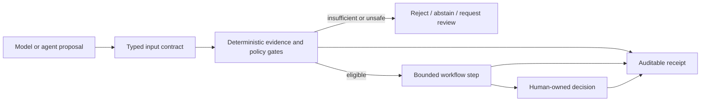

# Zhenpeng Liu | Project Portfolio

I build AI agents and scientific software that turn model outputs into artifacts people can inspect, test, and reproduce.

## Research and engineering from my résumé

| Project | What to look at |
| --- | --- |
| **Dynamics Atlas** · Scientific agent runtime | [Runtime and decision workflow](https://github.com/alex051107/dynamics-atlas-harness) · [Literature atlas and evidence flow](https://github.com/alex051107/dynamics-atlas-relaxdb/blob/main/PORTFOLIO.md). The runtime checks analysis proposals and tool outputs; the atlas organizes literature evidence into protein records. |
| **TaskFactory** · Multi-agent evaluation | [Engine and architecture](https://github.com/alex051107/agent-taskfactory-public). A LangGraph pipeline takes an evaluation task from rule selection and scorer design through blind review, freeze, and model trials. |
| **EvidenceOps** · Scientific evidence retrieval | [Pipeline](https://github.com/alex051107/evidenceops-public-mvp) · [Evidence console](https://alex051107.github.io/evidenceops-public-mvp/). Source identity and citations stay attached from retrieval to structured evidence and review. |
| **CarePlan** · Controlled drafting and human review | [Public workflow harness](careplan_workflow_harness/). Synthetic orders show where eligibility rules stop processing and where a human reviewer makes the final decision. |
| **HSP90 LiGaMD3** · Simulation and scientific ML | [Reproducible toolkit](https://github.com/alex051107/ligamd-pkoff-toolkit) · [Trajectory event harness](trajectory_event_harness/). Separate replica-level event detection and feature extraction from experimental-label prediction. |

## Selected project notes

- **[Legal Benchmark QA](portfolio/legal-benchmark-qa/):** Follow a fictional contract comparison through task design, blind review, scoring and repair. See how to distinguish a model mistake from a defective evaluation task.
- **[TrpB Path Planning](portfolio/trpb-path-planning/):** A structural biology proposal comparing direct interpolation with a partially closed waypoint, with explicit conditions for revising or holding a path.
- **[Benchmark QA Demo](portfolio/benchmark-qa-demo/):** Run an offline checker with synthetic fixtures and inspect the output.

[中文导航](README.zh-CN.md)

## Supporting control-plane project

[`career_agent_harness/`](career_agent_harness/) applies the same design to a
human-controlled job-search workflow: source freshness, evidence-backed
readiness, bounded scheduling, confirmation before external action, and an
allowlisted public snapshot. It never applies, sends, schedules, or records an
outcome by itself.

## Why these projects belong together



Across domains, an agent may propose work. It does not silently promote a
claim, mutate an external system, or take ownership of a human decision.

## Run the focused checks

All four public harnesses use Python's standard library at runtime.

```bash
python career_agent_harness/scripts/test_harness.py
python -m unittest discover -s careplan_workflow_harness/tests -v
python -m unittest discover -s scientific_evidence_harness/tests -v
python -m unittest discover -s trajectory_event_harness/tests -v
```

Each project README includes a small reproducible example and its own claim
boundary. The repository-level GitHub Actions workflow runs the same four test
suites when a harness changes.

## Public-release boundary

This repository intentionally excludes:

- resumes, portraits, personal contact records, application records, and raw
  interview or meeting transcripts;
- API keys, tokens, cookies, credentials, private environment files, and local
  absolute paths;
- real patient or customer data;
- unpublished assay tables, raw molecular-dynamics trajectories, topology
  files, collaborator records, and campaign-specific identity reconciliation;
- claims of production deployment, clinical effectiveness, autonomous external
  action, held-out Agent value, or physical `koff` estimation unless a separate
  public receipt supports them.

Examples are synthetic or use explicitly public sources. A passing test proves
the scoped software contract exercised by that test; it is not a deployment,
scientific-validation, or user-impact claim.

## Earlier prototypes

The repository also retains three earlier analytics prototypes:
[`bee_forecasting/`](bee_forecasting/),
[`water_level_forecasting/`](water_level_forecasting/), and
[`virtual_screening/`](virtual_screening/). They are preserved for code-reading
context and are not part of the current four-project evidence package. Their
roadmap language should not be interpreted as proof that every planned model,
data source, dashboard, or end-to-end run has been completed.
