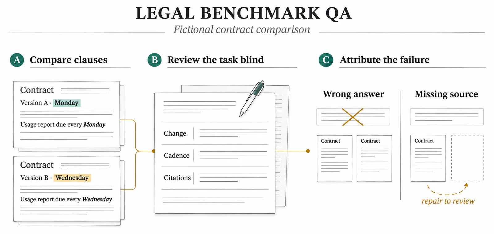

# Legal Benchmarks: Separating Response Failure from Task Defects

A quality-control case study using a fictional contract comparison. It shows why a benchmark must validate the task before interpreting a score.

*Figure 1. If both versions are present, reversing Monday and Wednesday fails the direction criterion. If Version B is missing, hold scoring, repair the packet, and repeat blind review before scoring.*

[Detailed review workflow](workflow.svg) · [Editable source](workflow.dot)

## Fictional task: What changed in the weekly reporting clause?

**Version A, §4:** “The vendor will send a usage report every Monday.”

**Version B, §4:** “The vendor will send a usage report every Wednesday.”

**Prompt:** Compare only these excerpts. State what changed, what stayed the same about the reporting cadence, and cite the clause in each version.

| Criterion | Observable evidence |
| --- | --- |
| Identify the change | States that delivery moved from Monday to Wednesday, in that direction. |
| Identify what stayed the same | States that the usage report remains weekly. |
| Ground both claims | Cites Version A §4 and Version B §4. |

## Review and scoring

1. **Blind review:** A reviewer answers from the supplied excerpts before seeing the answer key. Then they check whether the criteria are supported by the excerpts and cover the prompt. They flag ambiguities or missing evidence before the task is scored.
2. **Response failure:** A response says “Wednesday to Monday.” Both excerpts are present and unambiguous, so the direction criterion fails. Keep the task unchanged and record the failure against that criterion.
3. **Task defect:** The packet omits Version B, but the criteria still require identifying Wednesday and citing Version B §4. Hold the score because the evidence needed to answer is missing. Repair the packet as a new version and send it through blind review again before rescoring. The same repair loop applies if the defect is spotted during scoring rather than during review.

The key distinction: a missed criterion is evidence about the response only when the task gives the respondent a fair way to meet it.

