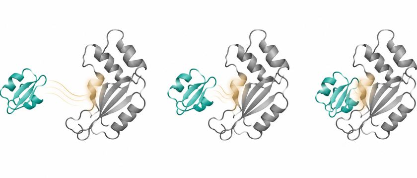
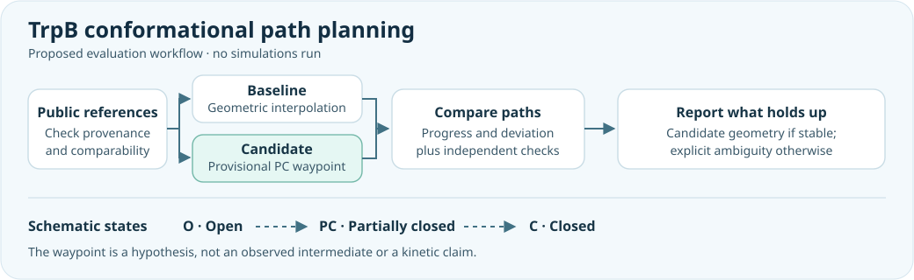

# TrpB Conformational Path Planning

**Independent research proposal · no simulations run**

How would we tell whether a proposed path for the communication (COMM) domain of the *Pyrococcus furiosus* tryptophan synthase β subunit is a useful description of conformational change, rather than an artifact of the starting structures or the choice of coordinates?

*ImageGen concept illustration. These are not structural models or simulated states.*

## Proposed workflow and decision gates

[Editable workflow](workflow.mmd) · [Editable state chart](states.mmd)

## Proposed approach

1. **Specify the comparison.** Start from published structural references. Record construct, biochemical state, missing regions, and provenance. Compare structures only where those differences can be accounted for.
2. **Compare candidate paths.** Treat open (O), partially closed (PC), and closed (C) as working labels. Compare a simple geometric interpolation baseline with a candidate route using PC as a provisional waypoint. Neither route is assumed to be the physical mechanism.
3. **Measure progress and deviation separately.** Use a path-coordinate concept to describe position along each route, with a second coordinate for distance from it. Keep independent structural descriptors, such as domain orientation and contact patterns, as a cross-check.
4. **Decide what the data would support.** Evaluate whether state labels and path rankings are consistent across alternative reference choices and independent repeats. Stop at a candidate geometry if the evidence is insufficient for a mechanistic claim.

## What success would look like

| Question | Proposed check | If the check fails |
| --- | --- | --- |
| Are the references comparable? | Check documented construct, biochemical state, alignment and structural coverage. | Limit the comparison or keep the references separate. |
| Does the waypoint improve the description? | Compare interpolation and waypoint models on held-out structures where available. Check whether independent structural descriptors agree with each one. | Keep the simpler baseline or report that the routes are not distinguishable. |
| Are the state labels robust? | Reassign states under alternative reference selections and compare independent repeats if obtained. | Report ambiguity instead of forcing a state label or transition order. |

The proposed deliverables are a provenance table, two candidate-path definitions, a state-assignment comparison, and a short record of unresolved assumptions. An enhanced-sampling study could be a later step. The planning work alone would not establish an obligatory intermediate, free-energy barriers, or transition rates.

## Status and scope

This portfolio entry describes a proposed workflow, not completed research. No simulations, benchmarks or experimental validation are reported here. This is not work performed at or endorsed by Caltech.

## Public references

- Buller et al., “Directed evolution of the tryptophan synthase β-subunit for stand-alone function recapitulates allosteric activation,” *PNAS* (2015). [Primary study on PfTrpB and COMM-domain motion](https://doi.org/10.1073/pnas.1516401112).
- Branduardi, Gervasio and Parrinello, “From A to B in free energy space,” *Journal of Chemical Physics* (2007). [Primary path-coordinate paper](https://pubmed.ncbi.nlm.nih.gov/17302470/).
