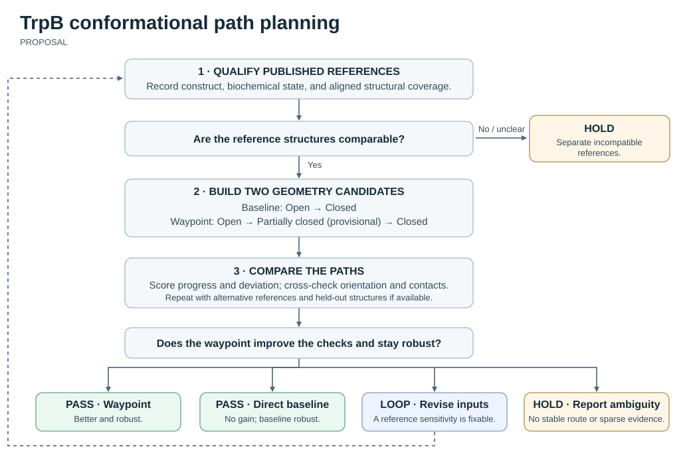

# TrpB Conformational Path Planning

**Status: Proposal**

Could a partially closed waypoint describe the communication domain of *Pyrococcus furiosus* tryptophan synthase β better than direct interpolation between open and closed structural references?

The proposal compares two candidate geometries using independent checks, including domain orientation and contact patterns. An explicit hold state keeps structurally incompatible references and inconclusive comparisons from becoming mechanistic claims. The planned outputs are a provenance table, candidate path definitions, and a short report documenting which conclusions the comparison supports. A candidate geometry would not by itself establish an obligatory intermediate, an energy barrier, or a transition rate.

**References:** [Buller et al., PfTrpB allostery and COMM-domain motion](https://doi.org/10.1073/pnas.1516401112) · [Branduardi et al., path collective variables](https://pubmed.ncbi.nlm.nih.gov/17302470/)
